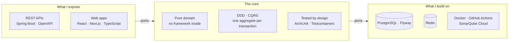
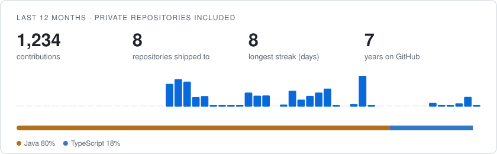

<!-- markdownlint-disable MD033 MD041 -->

<h1 align="center">Carlos Martínez Crespo</h1>

  Backend & Full-Stack Developer · Java · Spring Boot · React

  
  

I design backends around the domain, not the framework: hexagonal architecture, DDD and CQRS on
Java & Spring Boot, with React & Next.js on the front. I care about code that's readable, testable
and built to last, and about the process around it: every change proposed, reviewed and archived
before it ships.

## How I build

Also worked with: Vue · Node.js · NestJS · MongoDB · Strapi · Kubernetes

## Selected work

My recent projects live in private repositories, so here's what's inside them instead of a link.

**boilerplate** · *private* · a reusable foundation for new products, backend and frontend

- A modular monolith: one Gradle module per bounded context, boundaries enforced by ArchUnit
- Domain events through a transactional outbox: the change and its events commit together, or neither does
- Every write is idempotent (`Idempotency-Key`), every change is audited down to the actor that made it
- Spec-driven workflow with OpenSpec: each feature is proposed, designed, reviewed and archived

`Java 25` `Spring Boot 4` `PostgreSQL` `Redis` `Next.js` `SonarQube Cloud`

**supermarkets** · *private* · price comparator across six Spanish supermarkets

- Scheduled scraping of Mercadona, Carrefour, Alcampo, ALDI, LIDL and DIA, coordinated across instances with ShedLock
- Hexagonal + DDD + CQRS backend with Redis caching and stateless JWT / OAuth2 security
- Observability end to end: Micrometer metrics, OpenTelemetry traces into Jaeger, structured JSON logs
- Next.js 16 frontend with its own visual identity, light and dark themes, Spanish and English

`Java 25` `Spring Boot 4` `PostgreSQL` `Redis` `OpenTelemetry` `Next.js` `Tailwind`

## Now

Building the catalog bounded context of the boilerplate.

## In numbers

  <picture>
    <source media="(prefers-color-scheme: dark)" srcset="assets/stats-dark.svg" />
    
  </picture>

Counts private repositories. Regenerated daily by a GitHub Action in this repo.

